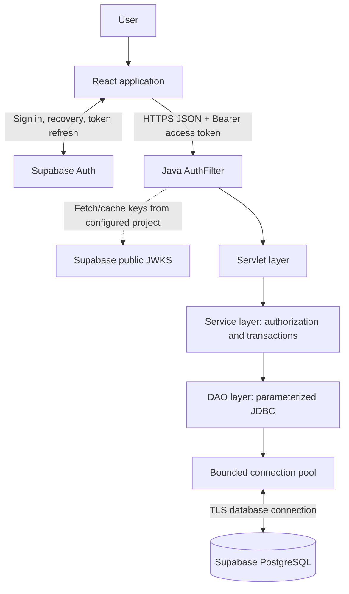
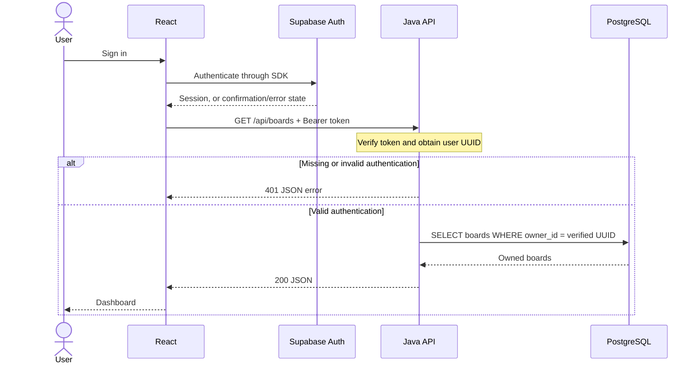
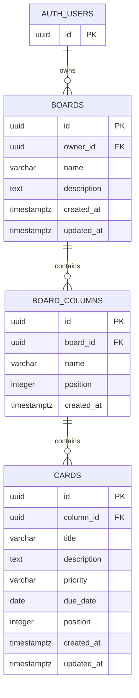
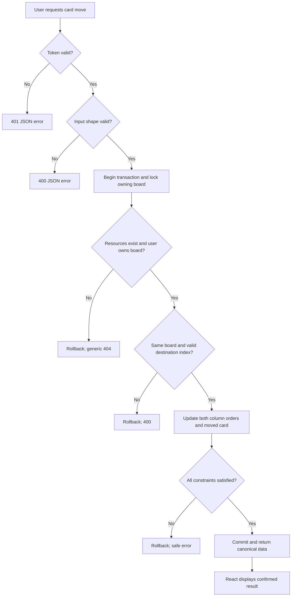

# Personal Kanban — Product Requirements Document

Version: 1.0 draft

Date: 2026-11-18

Status: Proposed implementation baseline; stack is agreed, scope defaults still need owner confirmation.

Related documents: [Implementation tasks](<TASKS.md>) · [Setup and credentials](<SETUP.md>)

## 1. Product summary

Build a personal Kanban web application for a university Java web project. A user signs in, creates boards, adds cards, and moves work through To Do, In Progress, and Done. Data persists across browser sessions and application restarts.

**Locked stack:** React + Java Servlets + JDBC + Supabase PostgreSQL + Supabase Auth.

**Architectural rule:** Supabase Auth manages identity; Java handles every board, column, and card operation. React must not query the Kanban tables through Supabase's Data API.

This is one React application and one layered Java backend, not microservices. JSP, JPA, Spring Boot, a second password system, and a second Java login session are not part of the proposed implementation.

## 2. Goals and success criteria

### Goals

1. Deliver a complete, usable personal task-management application.
2. Demonstrate HTTP handling, Servlet filters, Java business logic, JDBC queries, database constraints, and transactions.
3. Keep the scope small enough to explain and test thoroughly.
4. Protect each user's private boards and cards.
5. Provide reproducible setup and a clear course demonstration.

### Release success criteria

- Two separate test users can register, confirm email when enabled, sign in, and sign out.
- Each user can create, rename, open, and delete their own boards.
- Every new board starts with exactly three ordered columns.
- Cards can be created, edited, deleted, and moved without losing data or producing duplicate positions.
- Saved data remains after a browser refresh, a new sign-in, and a backend restart.
- A second user cannot read or mutate another user's board or any child resource, even with a known UUID.
- Invalid or expired tokens are rejected by Java, not just by the React router.
- All required automated tests pass and the manual release checklist is completed.
- No credentials, authentication tokens, or real user data are committed or included in build artifacts, screenshots, or logs.

No grade, response-time guarantee, or user-volume claim is implied by this PRD.

## 3. Audience, assumptions, and boundaries

### Primary user

A student or individual who wants a simple visual overview of personal work.

### Scope assumptions

- Email/password authentication via Supabase Auth.
- Personal boards only; one owner per board.
- Fixed columns for the MVP: To Do, In Progress, Done.
- No production data migration from the existing Spring Boot application by default.
- The teacher has approved React and externally managed authentication; reconfirm if this is not yet true.
- A dedicated development Supabase project is preferred.
- English UI for the initial release; change this before writing final UI copy if another language is required.
- Planning does not authorize application deployment, database changes, secret rotation, or rewriting Git history.

### Non-goals for the MVP

Shared boards, invitations, roles, assignments, comments, file uploads, real-time synchronization, notifications, social sign-in, billing, offline editing, account deletion, custom columns, and a mobile-native application.

Drag-and-drop, filtering, and search are optional enhancements. Button-based movement is required so the app does not depend on drag-and-drop.

## 4. Functional requirements

### AUTH-01 — Registration and email confirmation

- Register through the Supabase SDK, never through custom Java password handling.
- Validate the form locally for usability; Supabase remains the authentication authority.
- Handle both immediate-session and email-confirmation-required outcomes.
- Use configured callback URLs and safe internal return paths.
- Show an understandable pending-confirmation state; do not imply that registration always logs the user in.

Acceptance: a new test user completes the configured registration flow and can subsequently access the application.

### AUTH-02 — Login, logout, and session lifecycle

- Sign in through Supabase Auth.
- Let the SDK manage its session and token refresh; do not create another token store.
- Centralize Java API requests and attach the current access token only to the configured Java API origin/path.
- A protected React route prevents accidental navigation but is not an authorization control.
- Clear cached boards, cards, and other user-specific state on logout or account switch.
- On a Java 401, attempt at most one controlled refresh/retry where appropriate; otherwise request sign-in. Never retry indefinitely or replay arbitrary network-failed writes.

Acceptance: expiry is handled without infinite retries; user A's data does not remain visible after user B signs in.

Security limitation: a previously issued JWT can remain valid until its expiry after sign-out. Immediate token revocation is not promised in this locally verified JWT design.

### AUTH-03 — Password recovery

- Request a recovery email through Supabase Auth.
- Handle the recovery callback and password update flow using the SDK.
- Configure allowed redirect URLs explicitly.
- Display neutral request feedback that does not unnecessarily reveal whether an account exists.

Acceptance: a test user can recover access in the configured development environment. Email delivery/rate limits must be checked before the presentation.

### BOARD-01 — List and open boards

- Show only boards owned by the authenticated user.
- Display loading, empty, failure, and loaded states.
- Opening a board loads its details, columns, and cards in deterministic order.
- Private API responses must not be stored in shared caches.

Acceptance: direct requests for another user's board return a generic 404, and the dashboard never includes that board.

### BOARD-02 — Create and rename boards

- Name: required, nonblank after trimming, maximum 100 characters.
- Description: optional plain text, maximum 2,000 characters; null clears it on update.
- Derive owner UUID from verified authentication, never the request body.
- Create the board and its three default columns in one transaction.

Acceptance: a board creation failure leaves neither a partial board nor orphan columns.

### BOARD-03 — Delete boards

- Require explicit confirmation that cards will also be deleted.
- Authorize ownership on the server.
- Delete descendants using declared foreign-key cascade rules.
- Remove the deleted board from frontend state only after confirmed success.

Acceptance: no associated columns or cards remain after successful deletion.

### COLUMN-01 — Fixed workflow columns

- Automatically create To Do at position 0, In Progress at 1, and Done at 2.
- MVP users cannot create, delete, rename, or reorder columns.
- Store columns as rows so custom columns can be added later without redesigning card storage.
- Do not also store card status: a card's column is its workflow state.

### CARD-01 — Create and edit cards

- Title: required, nonblank after trimming, maximum 200 characters.
- Description: optional plain text, maximum 5,000 characters.
- Priority: LOW, MEDIUM, or HIGH; default MEDIUM on creation.
- Due date: optional calendar date, with no time-zone conversion. Past dates are allowed and can be shown as overdue.
- New cards append to the end of the selected column.
- Update semantics are explicit: PUT replaces editable fields; description and due date accept null to clear. Column and position are changed through the move operation only.
- The server rejects malformed UUIDs, unknown priority values, oversized fields, and invalid dates.

Acceptance: edits persist after reload, and an existing due date or description can be cleared.

### CARD-02 — Delete cards

- Ask for confirmation.
- Check access through card → column → board owner.
- Delete the card and close its ordering gap in one transaction.

Acceptance: remaining positions are contiguous and a subsequent create does not duplicate a position.

### CARD-03 — Move and reorder cards

- Provide a column selector and explicit move controls; include same-column move up/down controls.
- Support same-board moves only.
- newPosition is a zero-based final insertion index.
- For N cards in the same source/destination column, valid positions are 0 through N−1.
- For a different destination containing M cards, valid positions are 0 through M.
- Reject missing/inaccessible destinations and moves to another board.
- Update source ordering, destination ordering, and moved card in one transaction.
- Return/refetch canonical server data after the operation.
- Initially wait for server confirmation. If optimistic movement is added, restore or refetch on failure.

Acceptance: movement to first/last positions, no-op moves, empty destinations, and simultaneous operations all preserve unique, contiguous positions.

### UX-01 — Essential usability

- Dashboard, board, registration/login, confirmation/callback, and recovery views.
- Responsive layout with accessible scrolling for board columns on small screens.
- Keyboard-usable controls, visible focus, form labels, clear validation messages, and non-color-only status cues.
- Explicit loading, empty, network-error, and permission-error states.
- Prevent duplicate submissions while a mutation is pending.
- Display task descriptions as text; do not render stored raw HTML.
- Show changes as saved only after the server confirms them.

### ENH-01 — Optional enhancements

- Drag-and-drop with a keyboard/button equivalent.
- Title search and priority filtering on already loaded board data.
- Due-date filtering and visual polish.

These do not block the core release and must not weaken authorization or ordering correctness.

## 5. Architecture



### Backend responsibilities

- AuthFilter validates signature, allowed algorithm, expected issuer/audience, expiry and required identity claims, then exposes a request-scoped authenticated user UUID.
- JWT verification uses a maintained library and a trusted, configured JWKS URL, not a URL supplied by a token. Handle key rotation with bounded caching and refresh behavior.
- This baseline assumes asymmetric Supabase signing keys. Legacy HS256 projects require an explicit verification decision; do not request or copy a shared signing secret into React.
- Servlets parse routes and JSON, validate request shape, invoke services, and serialize DTOs.
- Services enforce ownership and business rules and control JDBC transactions.
- DAOs perform SQL and row mapping; no HTTP logic and no independent commits inside a service transaction.
- A startup/shutdown listener initializes services and the connection pool and closes resources during undeploy.
- Servlet instances must not store user/request state in mutable fields. Share the pool, never one Connection.
- Use try-with-resources for JDBC resources and roll back on failure.

### Browser responsibilities

- Supabase SDK for identity/session management only.
- A single API client for authentication headers and consistent errors.
- Feature-specific components and API functions.
- No jQuery DOM manipulation inside React; no Supabase `.from(...)` calls against application tables.

### Deployment

Development: Vite serves React and proxies `/api` to Tomcat. Production/submission: one HTTPS origin serves the React build and routes `/api` to Tomcat. Client routes may fall back to the React entry page; API routes must never fall back to HTML.

Version-control promotion is work branch → `develop` → `main`. `develop` is the default integration branch and the source for development/staging deployments; `main` is reserved for production-ready releases. Every change, including fixes and documentation, must pass through a pull request into `develop` before release promotion to `main`. Deployment pipelines must use separate environment secrets and approvals; no hosting or deployment automation is configured merely by creating these branches.

Use a compatible Jakarta Servlet/Tomcat/JDK set, pinned and smoke-tested during setup. Do not mix `javax.servlet` and `jakarta.servlet`. The installed latest JDK is not itself a requirement to target that bytecode version.

## 6. Authentication flow



## 7. ERD and data rules

Application tables live in a dedicated `kanban` schema that is not exposed by the Supabase Data API. `AUTH_USERS` below represents Supabase-managed `auth.users`, not an application-created users table.



### Schema requirements

- UUID primary keys and NOT NULL required fields.
- Board owner FK references `auth.users(id)` only; no passwords or auth-token copies in application tables.
- Board → column → card foreign keys use ON DELETE CASCADE.
- Default account-deletion policy: delete owned personal boards if an auth user is administratively removed. Account deletion has no MVP UI. Revisit this policy before adding collaboration.
- Board names/card titles have nonblank and length checks consistent with API validation.
- Priority has a CHECK constraint; position has a nonnegative CHECK constraint.
- Unique `(board_id, position)` for columns and `(column_id, position)` for cards. Card ordering constraints should be deferrable so a valid reorder can pass through temporary collisions within one transaction.
- Index boards by owner; index ordered children by parent and position. Avoid duplicating indexes already created by unique constraints.
- Store timestamps as `timestamptz`, due dates as `date`. Use a documented, consistent mechanism for updating `updated_at` on affected boards/cards.
- No separate card `status` or duplicated card `board_id`; resolve board through the column.
- No profile table needed initially. Add one only when display-name/avatar features are approved.

### Concurrency and ordering

Positions are zero-based, unique, and contiguous within each column. All create/delete/move operations affecting a board acquire the same board-row lock within a database transaction, then read current state and recheck permissions/existence before writing. Board deletion participates in the same serialization strategy.

The service owns the transaction, defers the ordering uniqueness constraint where needed, and passes one connection to participating DAO methods. A column count is safe as an append position only while the dense-order invariant holds and the board lock prevents concurrent appends.

The MVP serializes mutations and evaluates moves against current server state; it does not promise conflict merging or real-time multi-tab updates. Return canonical data/refetch after mutations. Full card edits use last-successful-write semantics; optimistic version checks may be added later.



## 8. API contract baseline

All endpoints below require authentication. `{id}` notation describes the contract; plain Servlet URL mappings require explicit path parsing.

| Method | Endpoint | Result |
|---|---|---|
| GET | `/api/boards` | 200: owned board summaries |
| POST | `/api/boards` | 201: board with three initial columns |
| GET | `/api/boards/{id}` | 200: board, ordered columns, ordered cards |
| PUT | `/api/boards/{id}` | 200: updated board details |
| DELETE | `/api/boards/{id}` | 204: no body |
| POST | `/api/columns/{id}/cards` | 201: created card |
| PUT | `/api/cards/{id}` | 200: updated card |
| DELETE | `/api/cards/{id}` | 204: no body |
| POST | `/api/cards/{id}/move` | 200: updated board snapshot |

Add a minimal public `/api/health` endpoint that discloses no configuration or secrets. There are no custom Java registration, password-login, or JWT-issuing endpoints.

Example move input:

```json
{
  "targetColumnId": "7c37b398-0800-4f36-8490-f19d98c29106",
  "newPosition": 2
}
```

Error envelope:

```json
{
  "error": {
    "code": "VALIDATION_ERROR",
    "message": "Title is required.",
    "fieldErrors": { "title": "Enter a title." }
  }
}
```

- 400: malformed or invalid request.
- 401: absent/invalid/expired authentication.
- 404: nonexistent resource or not owned by the caller; avoid disclosing another user's resource existence.
- 405: unsupported HTTP method.
- 409: a defined recoverable write conflict, where applicable; do not map every SQL failure to 409.
- 413: body exceeds configured size limit.
- 415: unsupported body media type.
- 500/503: internal error or temporary dependency failure, without SQL/stack/secret disclosure.

Set JSON content types and UTF-8 explicitly. Apply request-body size limits and a documented policy for unknown fields; reject unsupported ownership/identity fields rather than using them.

## 9. Security and operational requirements

1. Authentication and resource authorization are separate checks; both are required.
2. Use a dedicated runtime DB role with only required schema usage and table DML grants. No schema creation, role management, or auth-table reads for normal operations.
3. Use a separate elevated migration path. Migration credentials do not belong in the running application.
4. Keep the application schema outside exposed Data API schemas and do not grant direct access to anon/authenticated browser roles. Verify this configuration rather than assuming it.
5. JDBC connections do not automatically carry the Supabase end-user identity. Do not rely on `auth.uid()` policies as if Java were a Supabase Data API request.
6. Use SQL parameters, server validation, and ownership predicates. No string-concatenated user input in SQL.
7. Use HTTPS for deployment and TLS for the DB; verify the DB certificate/hostname in the deployment configuration.
8. Do not render raw user HTML. Configure an appropriate Content Security Policy and safe response headers for the final deployment, including the required Supabase Auth connections.
9. CORS does not replace authorization. Prefer same-origin API routing; if cross-origin deployment is selected, explicitly allow only approved origins and handle OPTIONS correctly.
10. Do not log passwords, DB URLs containing secrets, bearer headers, or recovery tokens. Logs may include non-sensitive request IDs and failure categories.
11. Configure finite database connection/query timeouts and a bounded pool, with clean shutdown and safe unavailable responses.
12. Before reusing the old project, rotate the previously exposed DB credential and retire/rotate the old application's JWT key as applicable. Do not confuse that key with a Supabase signing key.
13. Dependency versions and the JDK/Tomcat compatibility matrix must be pinned and recorded before implementation.

## 10. Testing and release evidence

### Automated

- Unit: input validation, route parsing, ownership rules, token claim validation, move boundaries.
- Integration with isolated PostgreSQL: schema constraints, CRUD, rollback, cascades, and concurrent order mutations.
- HTTP: valid/missing/expired/wrong-issuer/wrong-audience tokens; two-user cross-resource access; JSON error behavior.
- Frontend: authentication loading/error states, null field clearing, mutation errors, cache clearing.
- End-to-end: register/confirm where configured, login, create board/card, move, reload, edit, delete, logout.

Do not run destructive tests against a production or shared course database. Use fixture keys/tokens locally and a clearly separate test database/project. A local database can include a minimal test-only `auth.users` fixture; never deploy that fixture over Supabase's managed auth schema.

### Manual

- Keyboard-only core flow and mobile-width board navigation.
- Failed request does not falsely report a saved change.
- Two-user privacy demonstration.
- Persistence after backend restart.
- Confirmation/recovery callbacks work on the demo URL.
- README setup and migration steps succeed from a clean checkout.
- No secrets in Git history/current files or built frontend.

## 11. Proposed repository layout

This is a proposed new implementation layout, not a description of existing files.

```text
kanban/
├── frontend/
│   ├── package.json
│   ├── vite.config.js
│   ├── .env.example
│   └── src/
│       ├── main.jsx
│       ├── App.jsx
│       ├── auth/             # provider and route guard
│       ├── lib/              # Supabase client and Java API client
│       ├── features/
│       │   ├── auth/         # login, registration, callback, recovery
│       │   ├── boards/       # dashboard, board view, board API
│       │   └── cards/        # card UI/forms and card API
│       ├── components/       # shared layout and controls
│       └── styles/
├── backend/
│   ├── pom.xml               # Maven WAR, no Spring Boot/JPA
│   └── src/
│       ├── main/java/com/kanban/
│       │   ├── config/       # environment, pool, bootstrap listener
│       │   ├── security/     # auth filter and token verifier
│       │   ├── servlet/      # HTTP layer
│       │   ├── service/      # authorization and transactions
│       │   ├── dao/          # parameterized JDBC
│       │   ├── model/
│       │   ├── dto/
│       │   └── http/         # JSON and error handling
│       ├── main/webapp/WEB-INF/
│       └── test/java/com/kanban/
├── database/migrations/      # reviewed, ordered SQL migrations
├── docs/                     # architecture, API, demo guide
├── .gitignore
└── README.md
```

## 12. Decisions needed before implementation

| Decision | Recommended default |
|---|---|
| New repository or conversion of existing code? | Separate new implementation; preserve existing Spring Boot checkout |
| Deadline and team size? | User to provide; determine enhancement scope afterward |
| Existing data must be retained? | No migration unless explicitly requested |
| Supabase environment? | New development project with synthetic data |
| Sharing required for assessment? | No, personal boards only |
| Drag-and-drop required? | Enhancement after movement correctness is proven |
| Deployment target? | Local demo first; one public HTTPS origin later |
| Signing configuration? | Supabase asymmetric signing keys |
| Java/Tomcat versions? | Compatible maintained Jakarta stack, pinned during setup |

See [Implementation tasks](<TASKS.md>) for dependencies and [Setup and credentials](<SETUP.md>) for the exact access needed.

## References

- [Supabase JWT verification](https://supabase.com/docs/guides/auth/jwts)
- [Supabase PostgreSQL connections](https://supabase.com/docs/guides/database/connecting-to-postgres)

These links are implementation references; project settings and current supported versions must be verified when implementation begins.
