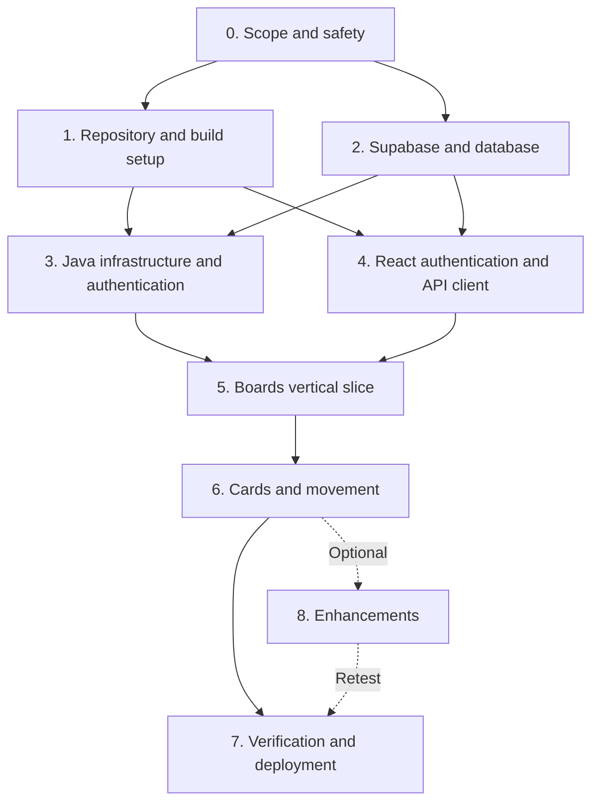

# Personal Kanban — Implementation Task Breakdown

Date: 2026-11-18

Baseline: [PRD](<PRD.md>) · [Setup and credentials](<SETUP.md>)

## How to use this backlog

This document defines task acceptance criteria, not live completion status. See [implementation progress](<PROGRESS.md>) for approved scope, completed foundation work, remaining gates, and verification results. The existing Spring Boot repository remains unchanged.

Complete phases in dependency order. UI work can run against fixtures while backend work proceeds, but fixture-only behavior never counts as an integrated feature.

All tasks use work branches created from `develop`, with pull requests targeting `develop`. `develop` is the integration and development/staging deployment branch. Only a release pull request from `develop` may enter production branch `main`. Deployment automation and application CI remain separate implementation tasks; the branch-flow policy check is repository infrastructure.

Roles: **Owner** = project owner/user; **Agent** = implementation work; **Joint** = owner supplies approvals/configuration while the agent implements or verifies.

Size indicates relative effort, not a promised duration: **S** = focused change, **M** = several related changes, **L** = multi-layer work requiring substantial tests. A calendar estimate should follow the deadline/team-size decision and the first working vertical slice.

## Dependency overview

## Phase 0 — Scope, safety, and authorization

| ID | Task | Owner / size | Dependencies | Done when |
|---|---|---|---|---|
| T01 | Confirm MVP, teacher approval, deadline, team size, and demo language | Owner / S | None | Personal-board scope and any mandatory extras are recorded; absence of requirements is not treated as a promise of teacher acceptance |
| T02 | Choose new implementation location and data-retention policy | Joint / S | T01 | New project or migration branch is selected; existing code/data to preserve are identified; no overwrite is performed implicitly |
| T03 | Resolve previously exposed credentials | Owner / M | None | Old DB credential is rotated or a new development project is chosen; old application JWT key is retired/rotated where used; history cleanup, if needed, is separately authorized |
| T04 | Provision configuration and authorize development-only access | Joint / S | T01, T03 | Public values are supplied, server secrets are configured privately, and the target environment plus allowed operations are explicit |

**Gate:** No authenticated Supabase connection, role creation, or migration execution before T04. Code scaffolding and mock tests can proceed without secrets after the destination is agreed.

## Phase 1 — Repository and build foundation

| ID | Task | Owner / size | Dependencies | Done when |
|---|---|---|---|---|
| T05 | Create repository layout and secret/build exclusions | Agent / S | T02 | Frontend/backend/database/docs directories exist; real env files, credentials, node_modules, dist, and target are ignored; safe examples are tracked |
| T06 | Pin compatible JDK, Tomcat, Servlet API, Maven, Node, and frontend dependency versions | Agent / M | T05 | A reproducible version matrix is documented; Jakarta imports match Tomcat; no Spring Boot or JPA is included |
| T07 | Scaffold React with Vite and application routes | Agent / M | T06 | App shell, auth routes, dashboard, and board placeholder render; development /api proxy is configured |
| T08 | Scaffold Maven WAR and Servlet bootstrap | Agent / M | T06 | WAR deploys on the chosen Tomcat; health endpoint returns JSON; startup/shutdown listener works |
| T09 | Add baseline test and CI commands | Agent / M | T07, T08 | Frontend tests/build and backend unit tests/package run from documented commands without production credentials |

**Gate:** A React page can call the Java health endpoint through the development proxy. No second production server is started without deployment approval.

## Phase 2 — Supabase and database foundations

| ID | Task | Owner / size | Dependencies | Done when |
|---|---|---|---|---|
| T10 | Configure Supabase Auth and callback URLs | Joint / M | T04, T07 | Email/password, confirmation choice, recovery callbacks, and asymmetric signing configuration are verified; test-email delivery limitations are known |
| T11 | Write reviewed SQL migrations for boards, columns, and cards | Agent / M | T05 | DDL includes UUIDs, auth user FK, cascades, validation checks, timestamps, ordered-child indexes, and deferrable card-position uniqueness |
| T12 | Configure schema exposure and least-privilege runtime role | Joint / M | T04, T11 | Dedicated kanban schema is not exposed through Data API; browser roles cannot directly read/write it; runtime role has needed DML but no DDL/auth-table access |
| T13 | Apply migrations to the authorized development target | Joint / M | T11, T12 | Migrations succeed with the selected elevated execution path; migration history is recorded; runtime role connection is verified without logging secrets |
| T14 | Establish isolated database test fixtures | Agent / M | T09, T11 | Integration tests use a separate local/test PostgreSQL instance; auth-user fixtures never overwrite Supabase-managed auth tables |

**Gate:** The schema and runtime permissions are validated. Production/shared data is untouched. If the owner executes migrations manually, provide the SQL and verify only non-sensitive results.

## Phase 3 — Java infrastructure and authentication

| ID | Task | Owner / size | Dependencies | Done when |
|---|---|---|---|---|
| T15 | Implement environment loading and pooled JDBC connections | Agent / M | T08, T13 | Missing configuration fails clearly without revealing secrets; pool/query timeouts and TLS are configured; resources close on shutdown |
| T16 | Implement Supabase access-token verifier and AuthFilter | Agent / L | T08, T10 | Signature/algorithm/issuer/audience/expiry/subject checks pass; JWKS URL is trusted configuration; key refresh is bounded; rejected tokens return 401 |
| T17 | Implement route parsing, JSON DTOs, and common errors | Agent / M | T08 | Malformed input/UUIDs, content types, body limits, methods, and unknown ownership fields receive documented responses; no HTML stack traces leak |
| T18 | Implement transaction and ownership helpers | Agent / M | T14, T15, T16 | Verified user identity is request-scoped; services pass one Connection across DAOs; rollback and generic 404 behavior are tested |

**Tests attached to this phase:** missing token, malformed token, wrong signature/algorithm/issuer/audience, expired token, bad subject, permitted public health path, JWKS rotation/failure behavior, pool startup/shutdown.

## Phase 4 — React authentication and API integration

| ID | Task | Owner / size | Dependencies | Done when |
|---|---|---|---|---|
| T19 | Implement Supabase client, auth provider, and protected routing | Agent / M | T07, T10 | Loading/signed-out/signed-in states are correct; callbacks and subscriptions are cleaned up; no duplicate token store is introduced |
| T20 | Implement registration, login, logout, and recovery screens | Agent / L | T19 | Confirmation-required registration and recovery work; errors are understandable; logout clears user data |
| T21 | Implement central Java API client | Agent / M | T16, T17, T19 | Token goes only to the configured API; JSON/204/errors are handled; refresh/retry is bounded; no uncontrolled write retries occur |
| T22 | Build shared form, loading, error, and confirmation patterns | Agent / M | T07 | Controls have labels and focus handling; pending actions cannot double-submit; user text is rendered safely |

**Gate:** A real signed-in user can call an authenticated Java endpoint. Invalid authentication is denied server-side even if React guards are bypassed.

## Phase 5 — Boards end-to-end

| ID | Task | Owner / size | Dependencies | Done when |
|---|---|---|---|---|
| T23 | Implement board/column models and DAO queries | Agent / M | T11, T15, T18 | Parameterized CRUD and ordered board loading work against isolated PostgreSQL |
| T24 | Implement board services and Servlet routes | Agent / L | T17, T18, T23 | Create + three columns is atomic; list/detail/edit/delete enforce ownership; deletion cascades; editable-field update semantics match PRD |
| T25 | Implement dashboard and board view | Agent / L | T21, T22, T24 | Users can create, open, rename, and delete boards; loading/empty/failure states and confirmation are implemented |
| T26 | Verify board isolation and persistence | Agent / M | T14, T24, T25 | Two users cannot access each other's boards; data survives reload/restart; failed creation leaves no partial board |

**Gate:** Demonstrate login → create board → three columns → reload → same board, plus a denied request from a second user.

## Phase 6 — Cards and ordering

| ID | Task | Owner / size | Dependencies | Done when |
|---|---|---|---|---|
| T27 | Implement card models, DTOs, and DAOs | Agent / M | T23 | Queries use parameters; null description/due date mapping is correct; no duplicate status/board identity fields are stored |
| T28 | Implement card create/edit/delete service and endpoints | Agent / L | T18, T24, T27 | Ownership is resolved through the parent board; create/delete use the common board-lock protocol; delete compacts positions; date clearing works |
| T29 | Implement transactional move/reorder service | Agent / L | T18, T28 | Same-board/range checks, locking, deferred uniqueness, reindexing, and rollback preserve dense ordering; current state is reread under lock |
| T30 | Implement card forms, cards, and non-drag move controls | Agent / L | T22, T25, T28, T29 | All fields and clearing behavior work; column selector and up/down movement are keyboard-usable; UI displays server-confirmed order |
| T31 | Add ordering, concurrency, and failure integration tests | Agent / L | T14, T28, T29 | Create/delete/move races serialize correctly; injected mid-operation failures roll back; no duplicates/gaps/orphans remain |

**Required ordering cases:** empty column; first/last insertion; same-position move; same-column reorder both directions; cross-column move; delete-first then append; concurrent appends; concurrent moves; move versus delete; out-of-range index; cross-board target; wrong owner.

**Gate:** The core product is feature-complete only after T31 passes. Drag-and-drop is not a substitute for passing these tests.

## Phase 7 — Hardening, demonstration, and release

| ID | Task | Owner / size | Dependencies | Done when |
|---|---|---|---|---|
| T32 | Run end-to-end user journeys and authentication isolation tests | Agent / L | T20, T26, T30, T31 | Auth flows, CRUD, moves, refresh, account switching, and two-user privacy pass using test-only accounts |
| T33 | Complete responsive, keyboard, and failure-state review | Agent / M | T30 | Core flow works without drag/mouse; mobile columns are reachable; long text, empty boards, and network failures are handled |
| T34 | Review application and deployment security | Agent / L | T16, T21, T28, T29 | Ownership audit passes; Data API bypass is blocked; secrets/artifacts/logs are checked; private cache headers and deployment security headers are verified |
| T35 | Package and deploy to the explicitly selected demo target | Joint / M | T32, T33, T34 | HTTPS routing serves React and /api correctly; app-route refresh works; auth redirects match; TLS/health checks pass; no replacement server is started implicitly |
| T36 | Write setup guide, API reference, and course demo script | Agent / M | T24, T30 | A clean checkout can be built; migration/config instructions are accurate; architecture and Java responsibilities can be explained |
| T37 | Perform owner acceptance and release checklist | Joint / S | T35, T36 | Owner confirms the core scenarios; known limitations and optional exclusions are recorded; submission artifact contains no secrets |

For a local-only course demo, T35 becomes local packaging and demonstration verification; public deployment is not mandatory.

## Phase 8 — Optional enhancements

| ID | Task | Owner / size | Dependencies | Done when |
|---|---|---|---|---|
| E01 | Add drag-and-drop using existing move API | Agent / L | T30, T31, owner approval | Mouse/touch interaction works; keyboard/buttons remain; failure restores/refetches server state |
| E02 | Add title search and priority filters | Agent / M | T30, owner approval | Filters do not modify persisted ordering; empty results and reset behavior work |
| E03 | Add due-date filtering and final visual polish | Agent / M | T30, owner approval | Calendar dates display without timezone drift and status is not communicated by color alone |

Re-run affected release tests after any enhancement. Sharing, invitations, assignments, and realtime need a separate scope revision and schema/security design; they are not unestimated hidden tasks.

## Acceptance traceability

| PRD area | Primary tasks |
|---|---|
| AUTH-01 registration | T10, T19, T20, T32 |
| AUTH-02 login/session/logout | T16, T19, T20, T21, T32 |
| AUTH-03 recovery | T10, T20, T32 |
| BOARD-01/02/03 | T11, T23–T26 |
| COLUMN-01 | T11, T24, T25 |
| CARD-01/02 | T27, T28, T30, T31 |
| CARD-03 | T29–T31 |
| UX-01 | T22, T25, T30, T33 |
| Security/operations | T03, T04, T12–T18, T21, T34, T35 |
| Reproducible submission | T05–T09, T36, T37 |
| ENH-01 | E01–E03 |

## Credential/access gates

- **Before scaffolding:** no live credentials are needed; settle T01/T02.
- **Before live Auth integration:** project URL, publishable key, signing configuration, redirect URLs, and authorized dev-project access.
- **Before DB integration:** runtime JDBC URL/user/password/certificate configured privately; migrations executed through the chosen separate elevated path.
- **Before end-to-end tests:** two disposable test users with different UUIDs, plus permission to create/delete only synthetic application data.
- **Before deployment:** target/domain, secret provisioning method, and explicit permission for deployment actions. No hosting root password is needed in chat.

## Completion checklist

- [ ] Scope and destination approved.
- [ ] Exposed credentials resolved.
- [ ] Safe development configuration available.
- [ ] Version matrix and build commands documented.
- [ ] Migrations and runtime grants verified.
- [ ] Auth and token verification tested.
- [ ] Boards complete and isolated per user.
- [ ] Cards and ordering complete with transaction tests.
- [ ] Core frontend usable by keyboard and at mobile widths.
- [ ] Two-user end-to-end tests pass.
- [ ] Demo deployment/package verified.
- [ ] Documentation and secret scan complete.
- [ ] Owner accepts the release.
